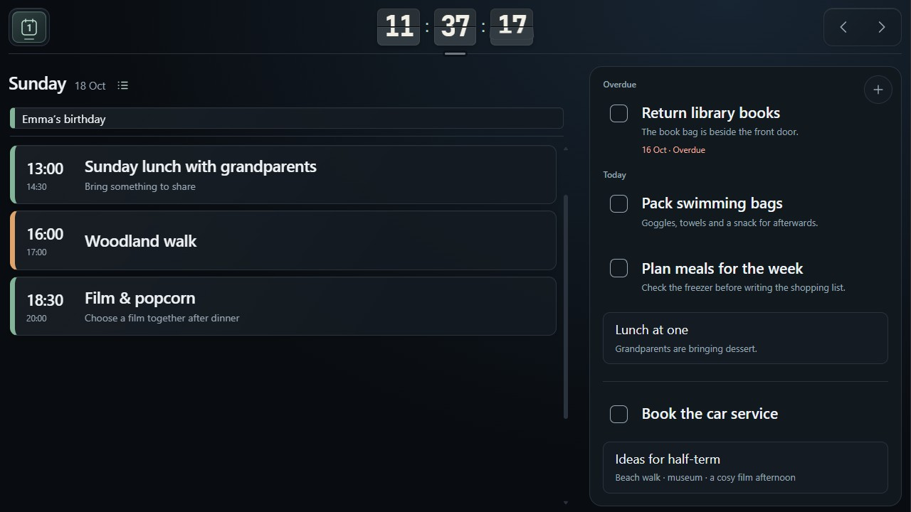
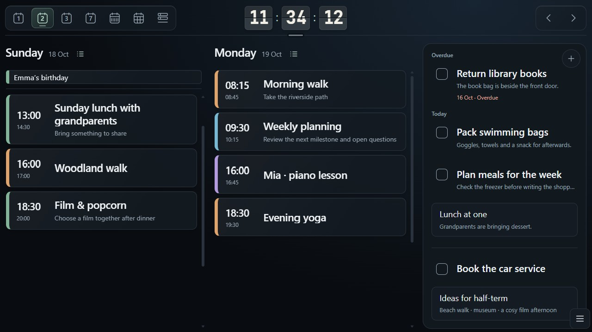
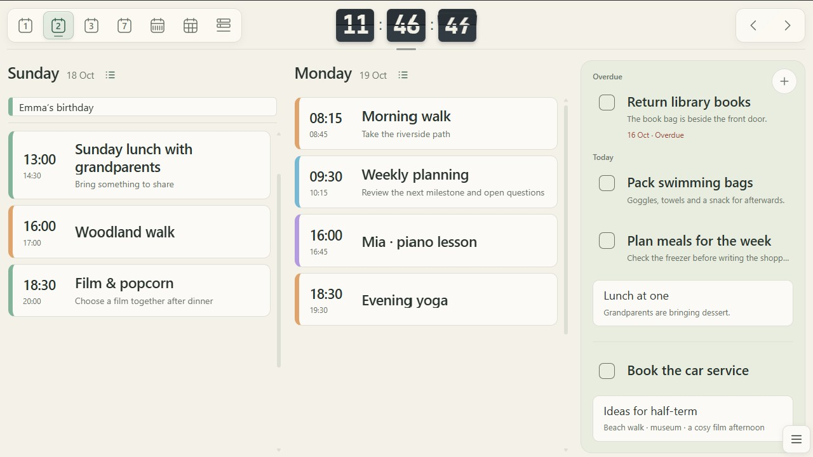
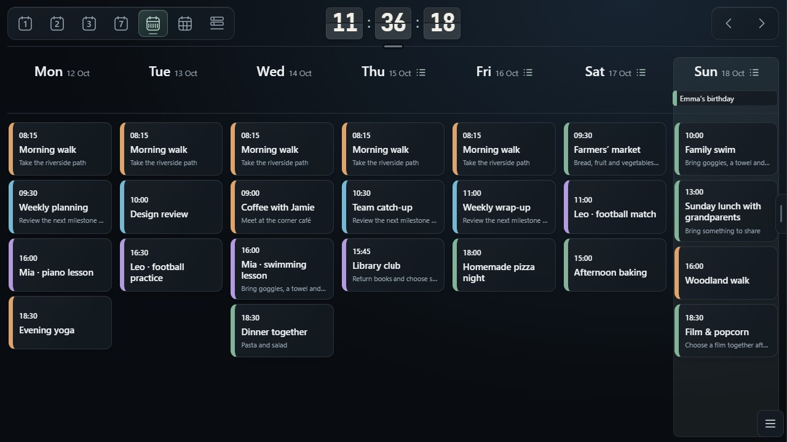
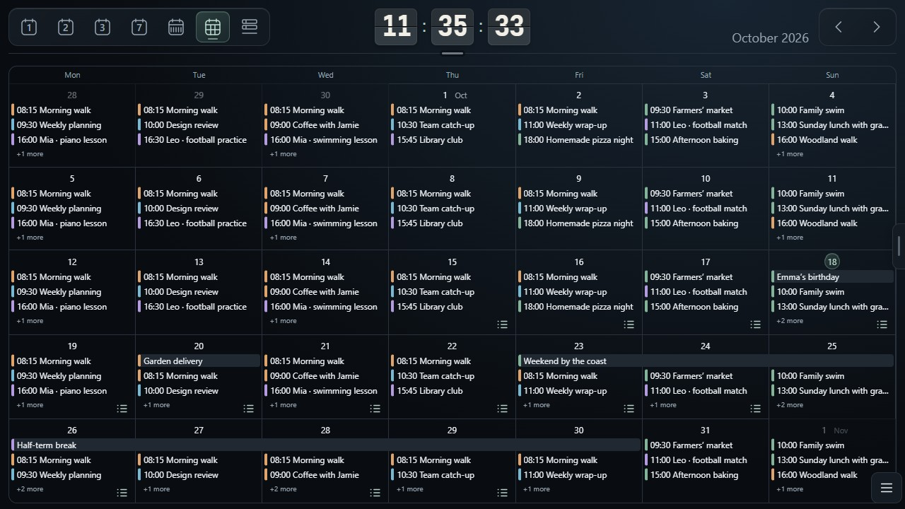
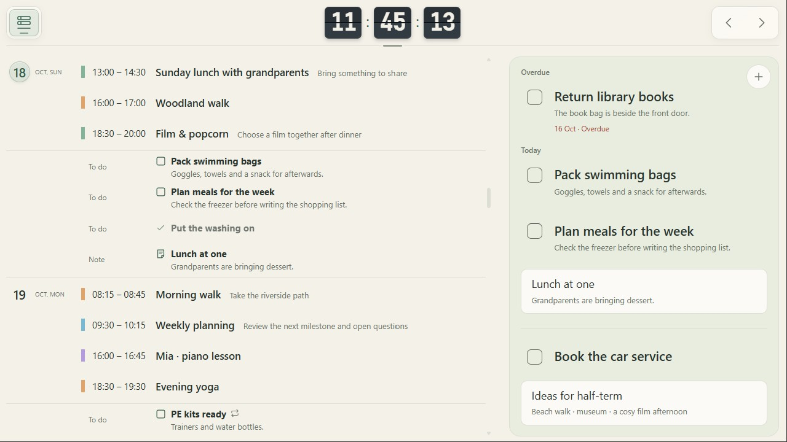
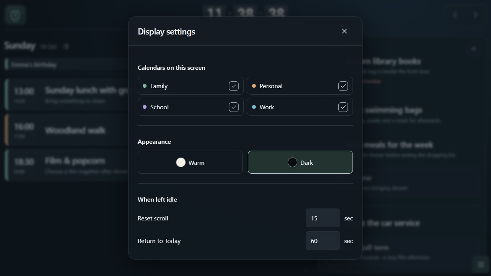
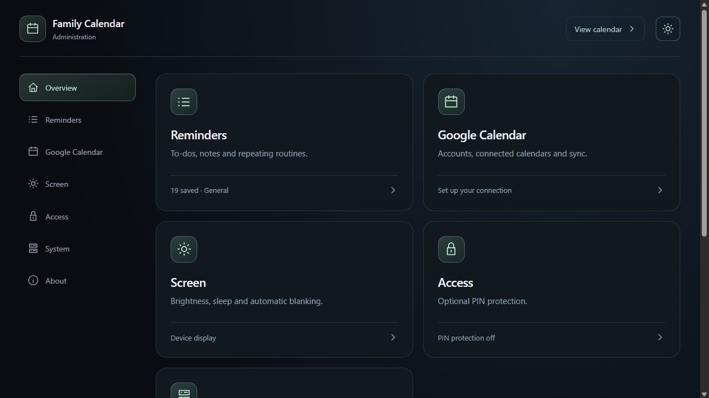

# Screenshot gallery

Pi Family Calendar with fictional demo events and reminders. [Back to the README](../README.md).

## Day

Today's events beside overdue, today's and anytime reminders.

## Two days

Two daily agendas with the reminder panel alongside.

### Dark theme

### Warm theme

## Week

Monday to Sunday, with today's column subtly highlighted.

## Month

An overview of the month, including multi-day events and daily reminder indicators.

## Schedule

Events, to-dos and notes in date order, shown in the Warm theme.

## Display settings

Calendar visibility, appearance and idle behaviour for each screen.

## Administration

A dedicated portal for reminders, Google Calendar connections, screen controls and access settings.

